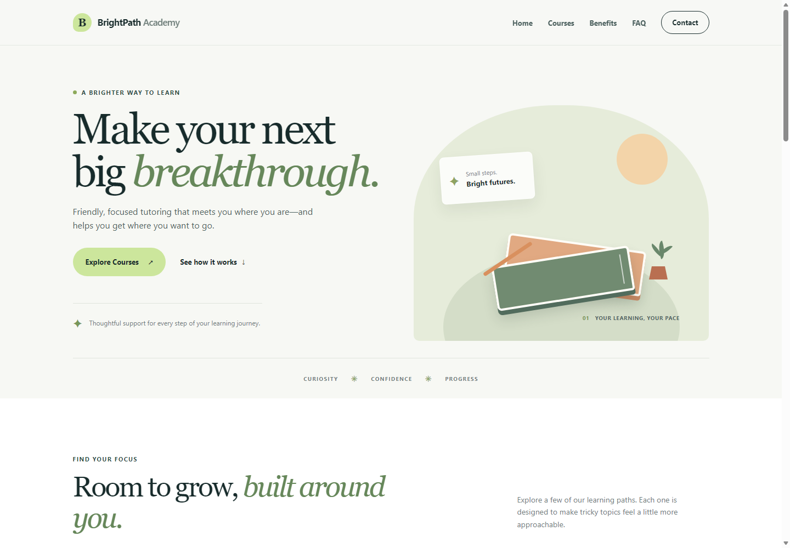
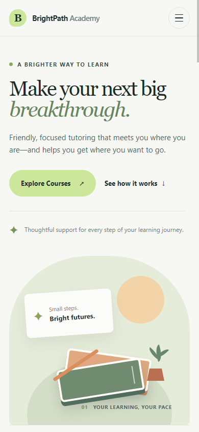

# BrightPath Academy

BrightPath Academy is a responsive landing page concept for a friendly tutoring service. It uses an elegant editorial style with forest-green text, muted green accents, and a light background.

**Live demo:** [BrightPath Academy](https://siddesh3448.github.io/brightpath-academy-landing-page/)

## Screenshots

| Desktop | Mobile |
| --- | --- |
|  |  |

## Features

- Responsive layout with a compact mobile navigation menu
- Course cards, benefits, sample testimonials, and interactive FAQ
- Accessible skip link, keyboard-friendly controls, and visible focus styles
- Contact form with client-side validation; it does not send or store submissions
- Custom SVG favicon and reduced-motion support

Testimonials shown on the page are fictional examples, not customer reviews.

## Technologies

- HTML5
- CSS3
- Vanilla JavaScript
- SVG

No frameworks, external fonts, or runtime dependencies are required.

## Run locally

Open `index.html` in a browser. The page is static and works without a build step or server.
